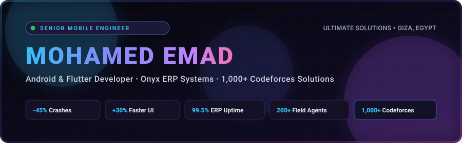

<div align="center">

  <!-- Native SVG Header (Host in your repo as ./header.svg for 100% uptime & zero broken links) -->
  <a href="https://mohamedemad7299.github.io">
    
  </a>

  <!-- Dynamic Typing Title -->
  <p align="center">
    <a href="https://mohamedemad7299.github.io">
      
    </a>
  </p>

  <p align="center">
    <strong>📍 Giza, Egypt</strong> &nbsp;•&nbsp; 
    <strong>🏢 Mobile Developer @ Ultimate Solutions</strong> &nbsp;•&nbsp; 
    <strong>🧠 Algorithmic Problem Solver</strong>
  </p>

  <!-- Connect & Live Profile Badges -->
  <p align="center">
    <a href="https://mohamedemad7299.github.io" target="_blank">
      
    </a>
    <a href="https://www.linkedin.com/in/mohamed-emad-450719217" target="_blank">
      
    </a>
    <a href="mailto:mohamedemad199912@gmail.com">
      
    </a>
    <a href="https://wa.me/201020766525" target="_blank">
      
    </a>
    
  </p>

</div>

---

### ⚡ Executive Summary

Senior Mobile Engineer with **3+ years of production experience** architecting and maintaining mission-critical Android and Flutter applications for **enterprise ERP ecosystems and high-volume e-commerce platforms**. Currently full-time at **Ultimate Solutions** maintaining the flagship Onyx ERP field distribution suite handling millions of dollars in monthly volume.

Proven track record of engineering offline-first, crash-resilient architectures for low-connectivity environments and non-flagship devices. Backed by **1,000+ competitive programming solutions on Codeforces**, translating deep algorithmic mastery (dynamic programming, graph theory, time/space complexity optimization) directly into sub-16ms UI rendering, zero main-thread blockage, and robust memory management.

---

### 📊 Impact & Production Metrics

<div align="center">

| Metric | Achievement | Operational Context |
| :---: | :--- | :--- |
| **📉 -45%** | **Crash Reduction** | Systematic stabilization, memory leak fixes & concurrency refactoring across 2 legacy distribution apps |
| **⚡ -30%** | **Faster Screen Latency** | Optimized DB queries, lazy layouts, and cold-start pipeline for 200+ field sales agents |
| **🛡️ 99.5%** | **Enterprise ERP Uptime** | High-availability syncing with Onyx & Onyx IX ERP handling **$2M+ in monthly transactions** |
| **📦 5,000+** | **Daily Inventory Moves** | Flutter military logistics system with **98% tracking accuracy** and **-60% manual errors** |
| **⏱️ &lt; 30s** | **Archive Retrieval** | Shrunk paper document retrieval time from 15 minutes down to seconds for 150+ operational users |
| **🛒 +35%** | **Checkout Conversion Lift** | Engineered frictionless checkout funnels across 5 production e-commerce apps (10,000+ MAU) |
| **🧩 1,000+** | **Codeforces Solved** | Rigorous algorithmic problem solving in advanced algorithms and complex data structures |

</div>

---

### 💼 Field-Tested Professional Experience

#### 🔹 **Android & Flutter Developer** — *Ultimate Solutions*
`Jan 2025 — Present` | *Full-time · Giza, Egypt*
* **Onyx Distribution & Onyx IX Applications**:
  * Maintained and optimized two enterprise Android distribution applications operating in real-time under high transactional volume.
  * Slashed crash rates by **45%** and load times by **30%** across **200+ daily field agents** managing orders, stock, and live routes.
  * Reinforced backend synchronizations with **Onyx ERP** and **Onyx IX ERP**, sustaining **99.5% operational uptime** on over **$2M+ in monthly commercial transactions**.
  * Delivered **12+ critical feature extensions** on tight production deadlines, reducing field order processing duration by **25%**.
  * *Tech*: `Kotlin` · `Java` · `Android SDK` · `MVVM` · `Retrofit` · `SQLite` · `LiveData` · `Coroutines` · `Google Maps SDK` · `MPAndroidChart` · `Gradle`
* **Health Club & Facility Management App**:
  * Cross-platform Flutter mobile solution for access control, class bookings, and subscription memberships.
  * Built high-speed QR check-in engine for gym, pool, and sports studios ensuring rapid entry validation.
  * Architected state management using `BLoC`, maintaining steady 60fps frame rates and zero UI stutter across lower-spec Android devices.
  * *Tech*: `Flutter` · `Dart` · `BLoC` · `Dio` · `REST APIs` · `QR Scanner` · `Google Maps` · `Shared Preferences` · `Easy Localization`

---

#### 🔹 **Flutter Field Systems Engineer** — *Egyptian Armed Forces*
`Jan 2024 — Dec 2024` | *Full-time · Egypt*
* Engineered and deployed three core Flutter desktop/mobile enterprise applications, transitioning manual paper processes into single-source auditable systems:
  * **Warehouse Logistics System**: Managed **5,000+ daily inventory movements**, dropping manual bookkeeping errors by **60%** while achieving **98% goods tracking precision**.
  * **Digital Fax & Document Archive**: Replaced legacy physical file cabinets for **150+ active users**. Reduced document discovery and retrieval time from 15 minutes to **under 30 seconds** via timestamp and indexed metadata search.
  * **Gate & Perimeter Security Management**: Automated logging for **800+ daily entry/exit events**, enhancing institutional security audit compliance by **40%**.
* *Tech*: `Flutter` · `Dart` · `BLoC` · `Offline-First Architecture` · `Local Storage` · `Security Auditing` · `REST APIs`

---

#### 🔹 **Remote Android Developer** — *Arc*
`Jan 2023 — Dec 2023` | *Remote*
* Engineered and shipped **5 production mobile applications** across floral, bakery, and wholesale e-commerce verticals.
* Re-designed cart architectures, dynamic pricing, and checkout funnels, generating a **35% increase in checkout conversions**.
* Scaled systems to support **10,000+ monthly active users** and processed **500+ daily orders** with fluid UI responsiveness and payment gateway integrations.
* *Tech*: `Android SDK` · `Kotlin` · `Java` · `MVVM` · `REST APIs` · `Payment Gateways` · `Material 3`

---

#### 🔹 **Android Developer Intern** — *The Chance*
`Feb 2023 — Oct 2023` | *Internship*
* Built and optimized native Android apps in Kotlin and Java adopting **MVVM** and **Clean Architecture**.
* Integrated enterprise REST APIs in collaboration with senior engineers, architected offline-first caching via **Room Database**, and improved responsiveness using asynchronous Kotlin Coroutines.
* *Tech*: `Kotlin` · `Java` · `MVVM` · `Room Database` · `Material Design` · `REST APIs` · `Coroutines`

---

### 🛠️ Technical Loadout

<div align="center">

#### 💻 Programming Languages
<p>
  
  
  
  
  
  
</p>

#### 📱 Mobile Engineering (Android & Flutter)
<p>
  
  
  
  
  
  
</p>

#### 🏛️ Architecture & State Management
<p>
  
  
  
  
  
</p>

#### 💾 Networking, Storage & Backend
<p>
  
  
  
  
  
  
</p>

#### 🧪 Testing, Quality & Tooling
<p>
  
  
  
  
  
  
</p>

#### 🤖 AI-Native Engineering Workflow
<p>
  
  
  
  
</p>

</div>

---

### 🧠 Algorithmic Foundation & Competitive Programming

<div align="center">

```
  ┌────────────────────────────────────────────────────────────────────────┐
  │  1,000+ Verified Solutions on Codeforces                               │
  │  Graph Algorithms  •  Dynamic Programming  •  Greedy  •  Number Theory │
  └────────────────────────────────────────────────────────────────────────┘
```

</div>

> *"Competitive programming is not just about solving riddles—it is the engineering discipline of respecting compute cycles and memory boundaries."*

* **Sub-16ms Frame Rates**: In-depth understanding of computational complexity ($O(1)$, $O(\log n)$, $O(n)$) ensures heavy data manipulations never block the Android/Flutter main UI thread.
* **Resilient Concurrency**: Deep grasp of thread synchronization, race condition avoidance, and lock-free async streams across Coroutines and RxJava.
* **Low-Memory Footprint**: Strict object pooling, avoiding premature allocations, and eliminating garbage collection spikes in resource-constrained field hardware.

---

### 📈 GitHub Analytics & Activity

<div align="center">
  <table border="0">
    <tr>
      <td align="center" valign="middle">
        <a href="https://github.com/MohamedEmad7299">
          
        </a>
      </td>
      <td align="center" valign="middle">
        <a href="https://github.com/MohamedEmad7299">
          
        </a>
      </td>
    </tr>
  </table>
</div>

---

### 🎓 Education & Professional Certifications

#### 🎓 **Bachelor's Degree in Computer Science**
* **Institution**: Faculty of Computer and Information *(2019 — 2023)*
* **GPA**: `3.13 / 4.0`
* **Specialization**: Software Engineering, Advanced Data Structures, Relational Databases, and Operating Systems.

#### 📜 **Certifications & Credentials**
* 🎖️ **Flutter & Dart — The Complete Guide** — *Udemy (Abdallah Mansour)*
* 🎖️ **Essentials of Prompt Engineering** — *AWS Skill Builder*
* 🎖️ **AI Capabilities and Limitations** — *Certificate of Completion*
* 🎖️ **Claude 101** — *Anthropic*
* 🎖️ **One Million Prompters** — *Certified*
* 🎖️ **EF SET English Certificate (CEFR B2)** — *Upper Intermediate*

---

### 🚀 Highlighted Repositories

| Repository | Tech Stack | Description |
| :--- | :---: | :--- |
| 🌐 [**MohamedEmad7299.github.io**](https://github.com/MohamedEmad7299/MohamedEmad7299.github.io) | `HTML5` `GSAP` `Lenis` | Interactive cyber-minimalist personal developer portfolio and quest logs. |
| 🌙 [**al-qistas**](https://github.com/MohamedEmad7299/al-qistas) | `TypeScript` | The Ultimate Comprehensive Islamic Calculation & Astronomical Suite with Bilingual Ar/En & PDF reports. |
| 🛒 [**Route**](https://github.com/MohamedEmad7299/Route) | `Kotlin` `MVVM` | Production-ready native Android e-commerce mobile application implementing Clean Architecture. |
| 📑 [**MVVM-Documentation**](https://github.com/MohamedEmad7299/MVVM-Documentation) | `Markdown` `Android` | Exhaustive architectural handbook covering components, data flows, and enterprise patterns. |
| ✅ [**Taskaya**](https://github.com/MohamedEmad7299/Taskaya) | `Kotlin` `Jetpack` | Fast, minimalist task and productivity management app built for daily workflows. |
| 🍽️ [**kebda-el-fallah-menu**](https://github.com/MohamedEmad7299/kebda-el-fallah-menu) | `JavaScript` `PWA` | Interactive digital restaurant menu with QR code routing, Google Maps and WhatsApp ordering. |

---

### 📬 Direct Comms & Channels

<div align="center">
  <p>Available for senior mobile engineering roles, enterprise consulting, and high-impact contract quests.</p>

  <a href="mailto:mohamedemad199912@gmail.com">
    
  </a>
  <a href="https://www.linkedin.com/in/mohamed-emad-450719217" target="_blank">
    
  </a>
  <a href="https://wa.me/201020766525" target="_blank">
    
  </a>
  <a href="https://mohamedemad7299.github.io" target="_blank">
    
  </a>

  <br/><br/>
  <sub>© 2026 Mohamed Emad. Engineered with precision, uptime, and performance in mind.</sub>
</div>
