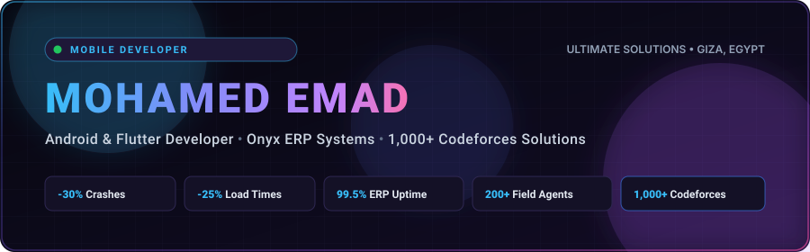

  <!-- Native SVG Header (Host in your repo as ./header.svg for 100% uptime & zero broken links) -->
  

  <!-- Dynamic Typing Title -->
  

    
  

  

    <strong>📍 Giza, Egypt</strong> &nbsp;•&nbsp; 
    <strong>🏢 Android &amp; Flutter Developer @ Ultimate Solutions</strong> &nbsp;•&nbsp; 
    <strong><a href="https://codeforces.com/profile/_UG_">🧠 1,000+ Codeforces solutions</a></strong>
  

  <!-- Connect & Live Profile Badges -->
  

    
    
    
    
    
  

---

### ⚡ Professional Summary

Mobile developer with **3+ years of experience** building Android and Flutter apps for ERP-integrated distribution, inventory management, and e-commerce. Experienced with Kotlin, Java, Dart, REST API integration, and mobile app performance optimization.

---

### 📊 Impact & Production Metrics

| Result | Context |
| :--- | :--- |
| **30% fewer crashes and 25% shorter load times** | Two Android distribution apps used by 200+ field agents |
| **5,000+ daily inventory transactions** | Warehouse system that reduced manual errors by 60% and reached 98% goods tracking accuracy |
| **Under 30 seconds to retrieve documents** | Digital fax workflow for 150+ users, down from 15 minutes |
| **35% increase in checkout conversion** | Streamlined checkout across five Android e-commerce apps |

---

### 💼 Work Experience

#### Android & Flutter Developer — Ultimate Solutions

`Jan 2025 – Present` · Full-time

- Reduced crashes by **30%** and load times by **25%** across two legacy Android distribution apps used by **200+ field agents** through bug triage, memory profiling, and performance optimization.
- Collaborated on migrating Onyx Distribution from native Android to Flutter.
- Built a document draft system that saved progress locally so users could resume unfinished documents after reopening the app.

#### Flutter Developer — Egyptian Armed Forces

`Jan 2024 – Dec 2024` · Full-time

- Built a warehouse management app that handled **5,000+ daily inventory transactions**, reduced manual errors by **60%**, and improved goods tracking accuracy to **98%**.
- Digitized the fax workflow for **150+ users**. Search by timestamp and recipient reduced document retrieval time from **15 minutes to under 30 seconds**.
- Developed a gate management system that logged **800+ daily entry and exit events** in real time, improving security audit compliance by **40%**.

#### Android Developer — Arc

`Jan 2023 – Dec 2023` · Remote

- Delivered **five production-ready Android e-commerce apps** for florists, bakeries, and wholesalers. The apps collectively served **10,000+ active users** and processed **500+ daily orders**.
- Built shopping cart and order management features that increased checkout conversion by **35%** through shorter load times and a simpler checkout flow.
- Built product detail screens that displayed pricing, product variants, and stock availability.
- Built reusable Android components for product listings and navigation across multiple storefronts.

#### Android Developer Intern — The Chance

`Feb 2023 – Oct 2023` · Remote · Internship

- Developed and optimized Android apps with Kotlin and Java using Clean Architecture, MVVM, and Material Design.
- Collaborated with developers to integrate APIs, manage local data with Room Database, and improve app performance through caching and asynchronous programming.

---

### 🛠️ Technical Skills

- **Programming languages** · Kotlin, Java, Dart
- **Android** · Jetpack Compose, Retrofit, Room Database, Coroutines, Hilt
- **Mobile technologies** · Flutter, Firebase, Sqflite
- **Conceptual knowledge** · Data structures, algorithms, object-oriented programming (OOP), RxJava, SQLite
- **Architecture patterns** · MVVM, MVC, MVP
- **Tools** · Git, Android Studio, Gradle, GitHub, GitLab, Figma
- **Soft skills** · Communication, attention to detail, prioritization, adaptability, teamwork, time management
- **State management** · BLoC, Provider, Riverpod, Cubit
- **Testing** · Unit testing, widget testing, mocking, Espresso
- **Languages** · Arabic (native), English (B2)

---

### 🚀 Projects

#### [Onyx Distribution](https://ultimatesolutionsportal.com/distribution-mobile) & [Onyx IX Distribution](https://yemensoft.com/en/onyx-ix-specialized-solutions/)

Ultimate Solutions · Android

- Built a location cache to record field reps’ locations and visited sites, enabling location-based check-in.
- Redesigned the app end to end, refactored multiple features, and fixed bugs to improve stability.

**Tech stack** · Kotlin, Java, Android SDK, MVVM, REST APIs, Retrofit, SQLite, LiveData, Coroutines, Google Maps, MPAndroidChart, Background Services, Gradle, XML

#### [Health Club Management System](https://yemensoft.com/en/motakamel-plus-erp-specialized-solutions/)

Ultimate Solutions · Flutter

- Implemented QR-based member check-in for gyms, pools, and studios.
- Designed session booking and membership subscription flows.
- Used BLoC for state management and Dio for REST API integration.

**Tech stack** · Flutter, Dart, BLoC, Dio, REST APIs, Easy Localization, QR Scanner, Google Maps, Shared Preferences

---

### 🎓 Education

**Bachelor’s degree in Computer Science**  
Minia University, Faculty of Computers and Information  
2019–2023 · GPA 3.13/4.00

---

### 📜 Certifications

- Flutter & Dart — The Complete Guide (Udemy, Abdallah Mansour)
- Essentials of Prompt Engineering (AWS Skill Builder)
- [AI Capabilities and Limitations](https://verify.skilljar.com/c/tpx8cabv4h62) certificate of completion
- [Claude 101](https://verify.skilljar.com/c/j88eymvts9ox) certificate of completion
- One Million Prompters
- [EF SET English Certificate](https://cert.efset.org/en/zxPPcr), B2 Upper Intermediate

---

### 🧠 Competitive Programming

Solved **1,000+ competitive programming problems** on [Codeforces](https://codeforces.com/profile/_UG_).

---

### 📈 GitHub Analytics & Activity

  <table border="0">
    <tr>
      <td align="center" valign="middle">
        
      </td>
      <td align="center" valign="middle">
        
      </td>
    </tr>
  </table>

---

### 📬 Contact

  
  
  
  

    
  © 2026 Mohamed Emad. Engineered with precision, uptime, and performance in mind.

